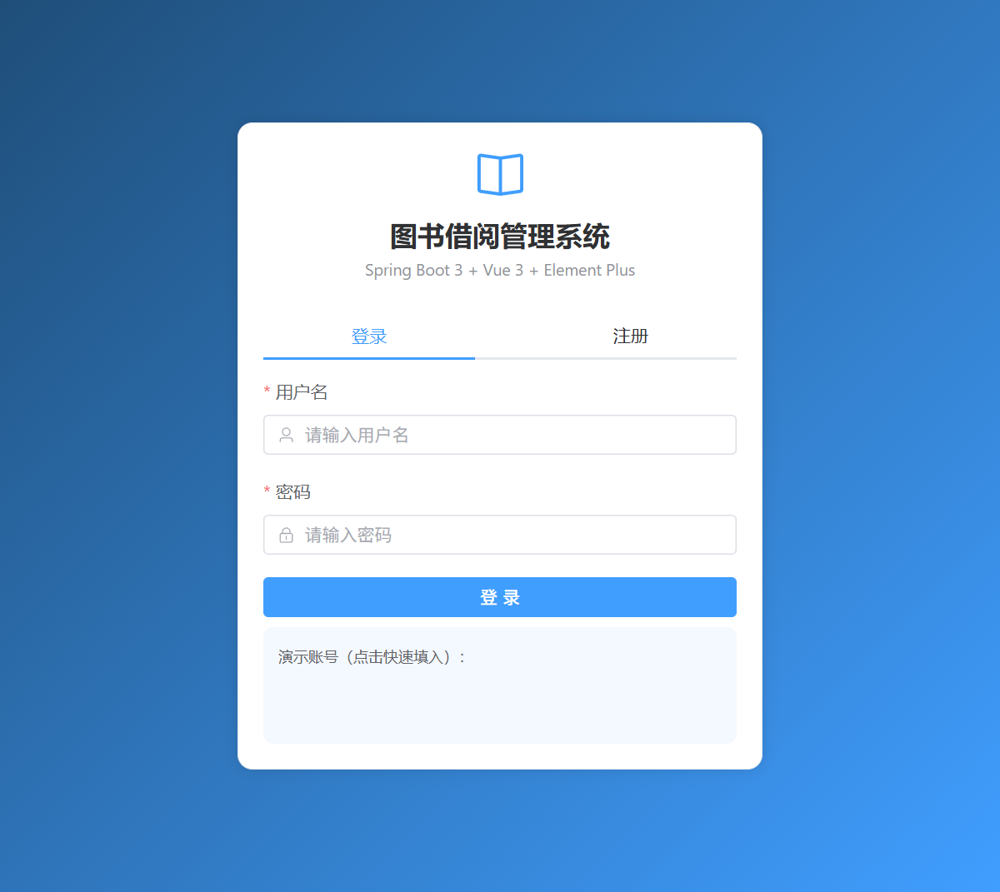
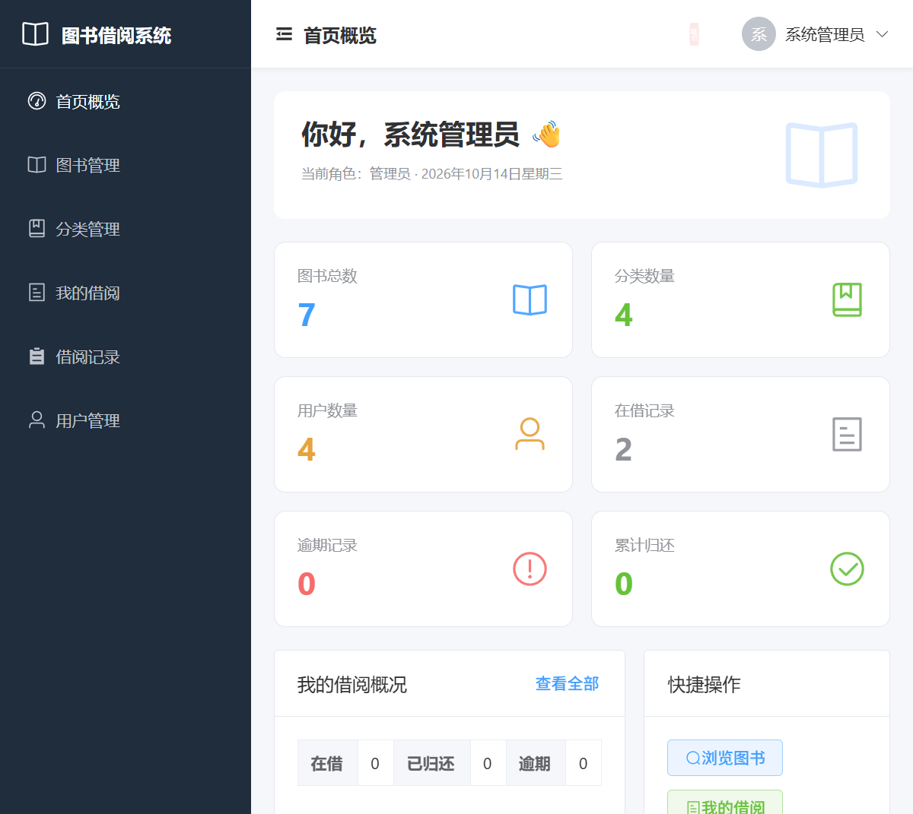
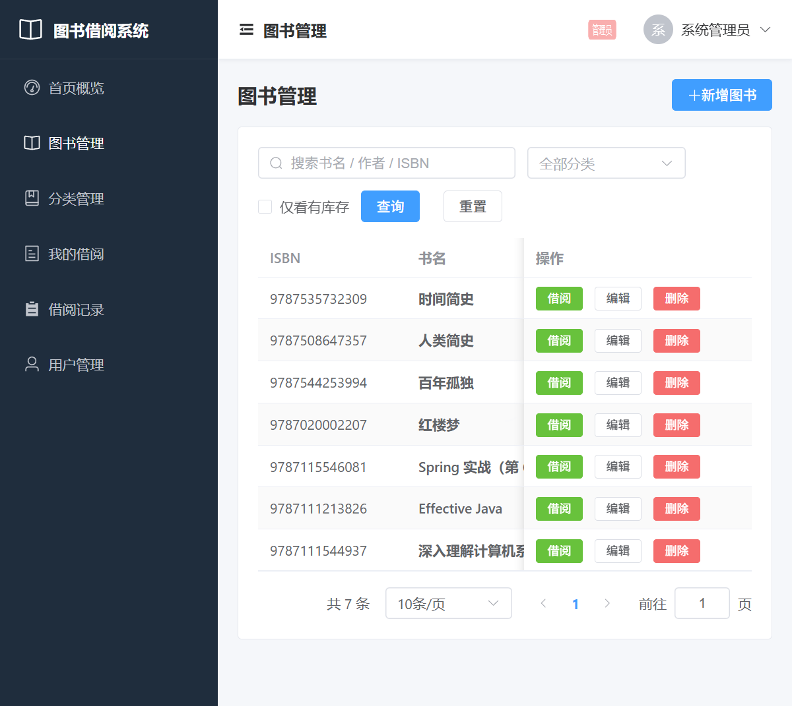
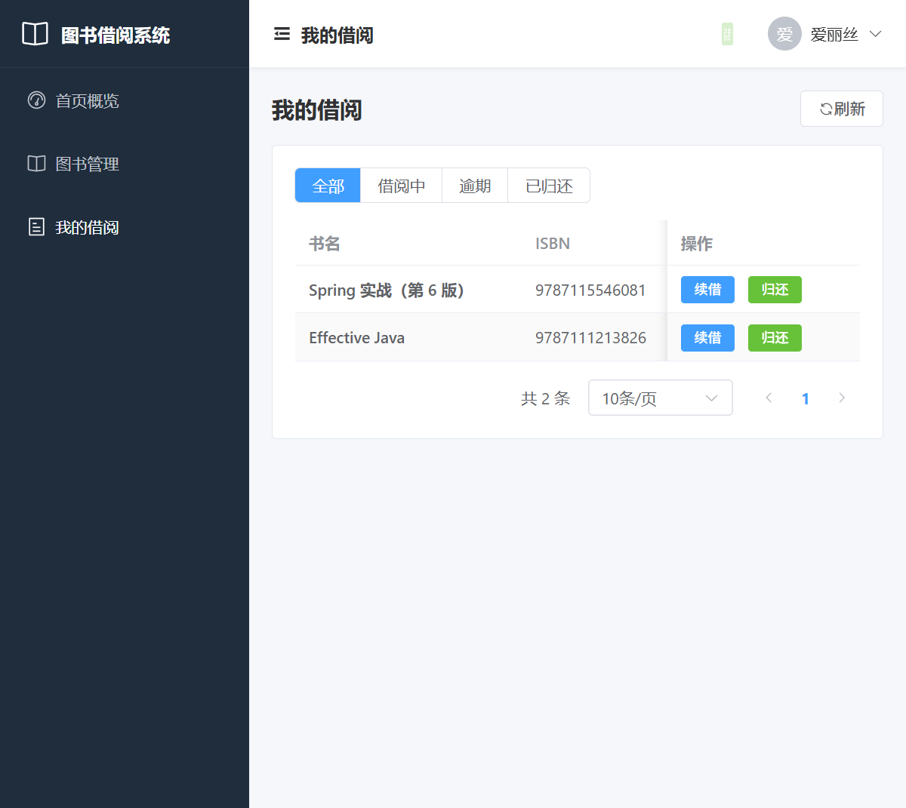

# 图书借阅管理系统 (Library Management System)

> 一个**前后端一体**的图书借阅管理系统：后端 **Spring Boot 3 + Spring Security(JWT) + Spring Data JPA**，前端 **Vue 3 + Vite + Element Plus**。
> 适合作为 Java 后端实习面试的完整作品：分层清晰、业务规则真实、含单元测试与集成测试、**一条命令即可运行**、带 Swagger 文档与 Docker 部署。

<p align="left">
  
  
  
  
  
  
  
  
</p>

---

## 目录

- [1. 项目简介](#1-项目简介)
- [2. 功能特性](#2-功能特性)
- [3. 界面预览](#3-界面预览)
- [4. 技术栈](#4-技术栈)
- [5. 系统架构](#5-系统架构)
- [6. 目录结构](#6-目录结构)
- [7. 快速开始](#7-快速开始)
- [8. 内置账号与演示数据](#8-内置账号与演示数据)
- [9. API 接口文档](#9-api-接口文档)
- [10. 核心业务规则](#10-核心业务规则)
- [11. 关键技术点](#11-关键技术点)
- [12. 测试](#12-测试)
- [13. Docker 部署](#13-docker-部署)
- [14. 配置说明](#14-配置说明)
- [15. 面试可讲的技术亮点](#15-面试可讲的技术亮点)
- [16. 后续可扩展方向](#16-后续可扩展方向)
- [17. License](#17-license)

---

## 1. 项目简介

本系统模拟一个图书馆的核心业务：**读者注册登录、浏览与检索图书、借书、还书、续借、逾期罚金计算**，
管理员可**管理图书、分类、用户与借阅记录**。提供完整的 Web 界面与 REST API。

项目刻意把「一个真实前后端项目应该有的东西」都做了一遍：

- 规范的**后端分层架构**（Controller / Service / Repository / Entity / DTO / Mapper）
- 基于 **JWT 的无状态认证** 与 **基于角色的接口授权**（ADMIN / LIBRARIAN / MEMBER）
- **真实的业务规则**（借阅上限、重复借阅校验、借阅期限、续借次数、逾期罚金）
- **并发安全的库存扣减**（数据库原子条件更新，避免超借）
- **统一响应结构 + 全局异常处理 + 参数校验**
- 现代化**前端**（Vue 3 组合式 API + Pinia 状态管理 + 路由守卫 + Axios 拦截器 + 角色化菜单）
- **单元测试 + 集成测试**（共 34 个用例，全部通过）
- **Swagger / OpenAPI** 在线文档、**Docker** 部署、可切换 **H2 / MySQL**、**前端构建产物打进同一个 jar**

---

## 2. 功能特性

| 模块 | 功能 |
| --- | --- |
| 认证 | 注册、登录、签发/校验 JWT 令牌 |
| 图书 | 新增、修改、删除、详情、分页检索（书名/作者/ISBN 模糊搜索、按分类过滤、仅看有库存） |
| 分类 | 增删改查；分类下有图书时禁止删除 |
| 借阅 | 借书、还书、续借、我的借阅记录、全部借阅记录（管理员）、逾期罚金计算 |
| 用户 | 当前用户信息、用户列表、修改角色、启用/禁用账号（管理员） |
| 统计 | 图书数、分类数、用户数、在借数、逾期数、已归还数 |
| 前端 | 登录/注册、数据看板、图书检索与借阅、分类管理、我的借阅、借阅记录、用户管理；按角色显示菜单 |

---

## 3. 界面预览

<table>
  <tr>
    <td width="50%"><b>登录 / 注册</b><br></td>
    <td width="50%"><b>首页看板</b><br></td>
  </tr>
  <tr>
    <td width="50%"><b>图书管理（检索 / 借阅 / 编辑）</b><br></td>
    <td width="50%"><b>我的借阅（续借 / 归还）</b><br></td>
  </tr>
</table>

---

## 4. 技术栈

| 分类 | 技术 |
| --- | --- |
| 后端语言 / 构建 | Java 21、Maven |
| 后端框架 | Spring Boot 3.3.5、Spring MVC、Spring Data JPA、Spring Security 6 |
| 认证 | JJWT 0.12.6（HS256） |
| 数据库 | H2（默认，内存，开箱即用）、MySQL 8（可选 profile） |
| 后端文档 | springdoc-openapi 2.6.0（Swagger UI） |
| 后端工具 | Lombok、Jakarta Bean Validation |
| 前端 | Vue 3（组合式 API）、Vite 5、Vue Router 4、Pinia 2、Axios、Element Plus 2 |
| 测试 | JUnit 5、Mockito、AssertJ、Spring Boot Test、MockMvc |
| 部署 | Docker、Docker Compose |

---

## 5. 系统架构

```
┌──────────────────────────────────────────────────────────────┐
│              浏览器 (Vue 3 SPA, 打包产物内置于 jar)             │
│   Element Plus 组件 · Pinia 状态 · Vue Router 路由守卫          │
└───────────────────────────────┬──────────────────────────────┘
                                │ HTTP + JSON  (Authorization: Bearer <JWT>)
┌───────────────────────────────▼──────────────────────────────┐
│                      Spring Security Filter Chain             │
│        JwtAuthenticationFilter → 解析令牌 → 写入 SecurityContext │
│        认证失败 → RestSecurityHandlers (统一 JSON 401/403)       │
└───────────────────────────────┬──────────────────────────────┘
                                │
┌───────────────────────────────▼──────────────────────────────┐
│  Controller 层   @RestController + @Valid 参数校验              │
│  Auth / Book / Category / Borrow / User / Stats / SpaForward   │
└───────────────────────────────┬──────────────────────────────┘
                                │ DTO
┌───────────────────────────────▼──────────────────────────────┐
│  Service 层  业务规则、事务边界 @Transactional                   │
│  AuthService / BookService / BorrowService / ...              │
└───────────────────────────────┬──────────────────────────────┘
                                │ Entity
┌───────────────────────────────▼──────────────────────────────┐
│  Repository 层  Spring Data JPA (+ Specification 动态查询)      │
└───────────────────────────────┬──────────────────────────────┘
                                │
┌───────────────────────────────▼──────────────────────────────┐
│                    H2 (默认)  /  MySQL (可选)                  │
└──────────────────────────────────────────────────────────────┘

横切关注点：GlobalExceptionHandler（统一异常）、ApiResponse（统一响应）、
          AuditingEntityListener（创建/更新时间自动填充）、@Scheduled（逾期刷新）
前端：Axios 拦截器（自动带 token、401 跳登录、统一错误提示）、路由守卫（登录与角色校验）
```

---

## 6. 目录结构

```
library-management-system
├── pom.xml
├── Dockerfile
├── docker-compose.yml
├── requests.http                     # 可直接执行的接口示例
├── docs/
│   ├── API.md                        # curl 接口示例
│   └── images/                       # 界面截图
├── frontend/                         # 前端工程 (Vue 3 + Vite)
│   ├── package.json
│   ├── vite.config.js                # 构建产物输出到 ../src/main/resources/static
│   ├── index.html
│   └── src/
│       ├── main.js
│       ├── App.vue
│       ├── api/                      # axios 封装与各模块接口
│       ├── router/                   # 路由与守卫
│       ├── stores/                   # Pinia 状态（登录态、用户信息）
│       ├── layouts/                  # 主布局（侧边栏 + 顶栏）
│       ├── views/                    # 页面：登录/看板/图书/分类/借阅/用户
│       └── styles/
└── src
    ├── main
    │   ├── java/com/bbttcc/library
    │   │   ├── LibraryApplication.java
    │   │   ├── config/               # Security / OpenAPI / 配置属性 / 数据初始化
    │   │   ├── controller/           # REST 控制器 + SPA 路由转发
    │   │   ├── dto/                  # 请求/响应对象（record）
    │   │   ├── entity/               # JPA 实体与枚举
    │   │   ├── exception/            # 自定义异常 + 全局异常处理
    │   │   ├── mapper/               # Entity <-> DTO 转换
    │   │   ├── repository/           # Spring Data JPA 仓储
    │   │   ├── security/             # JWT、UserDetails、Security 工具
    │   │   └── service/              # 业务逻辑
    │   └── resources
    │       ├── application.yml
    │       ├── application-mysql.yml
    │       └── static/               # 前端构建产物（由 npm run build 生成）
    └── test
        ├── java/com/bbttcc/library
        │   ├── controller/           # 集成测试（MockMvc）
        │   ├── mapper/               # 单元测试
        │   ├── repository/           # @DataJpaTest
        │   └── service/              # Mockito 单元测试
        └── resources/application-test.yml
```

---

## 7. 快速开始

### 7.1 环境要求

- JDK 17+（推荐 21）
- Maven 3.8+
- （仅前端开发需要）Node.js 18+ 与 npm
- 无需安装数据库：默认使用 **H2 内存数据库**

### 7.2 方式一：一条命令运行（推荐，前端产物已内置）

```bash
git clone https://github.com/BBTTCC123/library-management-system.git
cd library-management-system

mvn test                 # 运行 34 个测试
mvn clean package        # 打包（前端产物已在 static 目录中）
java -jar target/library-management-system-1.0.0.jar
```

启动后访问 **<http://localhost:8080>** 即可看到完整界面（无需单独启动前端）。

其他入口：

- Swagger UI：<http://localhost:8080/swagger-ui.html>
- H2 控制台：<http://localhost:8080/h2-console>（JDBC URL `jdbc:h2:mem:librarydb`，用户名 `sa`，密码留空）

### 7.3 方式二：前后端分离开发

```bash
# 终端 1：启动后端
mvn spring-boot:run

# 终端 2：启动前端开发服务器（Vite 已配置 /api 代理到 8080）
cd frontend
npm install
npm run dev          # 打开 http://localhost:5173，支持热更新
```

### 7.4 修改前端后重新构建

```bash
cd frontend
npm run build        # 产物输出到 ../src/main/resources/static
cd ..
mvn clean package    # 重新打包含最新前端的 jar
```

### 7.5 30 秒体验

```bash
# 登录获取令牌
curl -s -X POST http://localhost:8080/api/auth/login \
  -H "Content-Type: application/json" \
  -d '{"username":"admin","password":"admin123"}'

# 用令牌查询当前用户
curl -s http://localhost:8080/api/users/me -H "Authorization: Bearer <accessToken>"
```

更多示例见 [`docs/API.md`](docs/API.md) 或直接打开 `requests.http`。

---

## 8. 内置账号与演示数据

首次启动会自动写入演示数据（可通过 `app.seed.enabled=false` 关闭）：

| 用户名 | 密码 | 角色 | 说明 |
| --- | --- | --- | --- |
| `admin` | `admin123` | ADMIN | 系统管理员，拥有全部权限 |
| `librarian` | `librarian123` | LIBRARIAN | 图书管理员，可管理图书/分类/借阅 |
| `alice` | `alice123` | MEMBER | 普通读者 |
| `bob` | `bob123` | MEMBER | 普通读者 |

同时预置了「计算机 / 文学 / 历史 / 科学」4 个分类与 7 本图书。登录页可直接点击演示账号快速填入。

---

## 9. API 接口文档

统一响应结构：

```json
{
  "code": 200,
  "message": "success",
  "data": { },
  "timestamp": "2026-01-01T00:00:00Z"
}
```

| 方法 | 路径 | 说明 | 权限 |
| --- | --- | --- | --- |
| POST | `/api/auth/register` | 注册 | 公开 |
| POST | `/api/auth/login` | 登录 | 公开 |
| GET | `/api/books` | 分页检索图书 | 公开 |
| GET | `/api/books/{id}` | 图书详情 | 公开 |
| POST | `/api/books` | 新增图书 | ADMIN / LIBRARIAN |
| PUT | `/api/books/{id}` | 更新图书 | ADMIN / LIBRARIAN |
| DELETE | `/api/books/{id}` | 删除图书 | ADMIN / LIBRARIAN |
| GET | `/api/categories` | 分类列表 | 公开 |
| GET | `/api/categories/{id}` | 分类详情 | 公开 |
| POST | `/api/categories` | 新增分类 | ADMIN / LIBRARIAN |
| PUT | `/api/categories/{id}` | 更新分类 | ADMIN / LIBRARIAN |
| DELETE | `/api/categories/{id}` | 删除分类 | ADMIN / LIBRARIAN |
| POST | `/api/borrows` | 借书 | 登录用户 |
| POST | `/api/borrows/{id}/return` | 还书 | 记录本人 / 管理员 |
| POST | `/api/borrows/{id}/renew` | 续借 | 记录本人 / 管理员 |
| GET | `/api/borrows/me` | 我的借阅记录 | 登录用户 |
| GET | `/api/borrows/{id}` | 借阅记录详情 | 记录本人 / 管理员 |
| GET | `/api/borrows` | 全部借阅记录 | ADMIN / LIBRARIAN |
| GET | `/api/users/me` | 当前用户信息 | 登录用户 |
| GET | `/api/users` | 用户列表 | ADMIN |
| GET | `/api/users/{id}` | 用户详情 | ADMIN |
| PATCH | `/api/users/{id}/role` | 修改用户角色 | ADMIN |
| PATCH | `/api/users/{id}/enabled` | 启用/禁用用户 | ADMIN |
| GET | `/api/stats` | 统计信息 | 登录用户 |

图书检索支持参数：`keyword`（书名/作者/ISBN）、`categoryId`、`availableOnly`、`page`、`size`、`sort`。

---

## 10. 核心业务规则

| 规则 | 说明 | 实现位置 |
| --- | --- | --- |
| 借阅上限 | 每个读者同时最多借 **5** 本（可配置） | `BorrowService#borrow` |
| 重复借阅 | 同一本书未归还时不能再次借阅 | `BorrowService#borrow` |
| 库存校验 | 无可借库存时拒绝借阅 | `BookRepository#borrowOne`（原子更新） |
| 借阅期限 | 默认 **30** 天 | `BorrowService#borrow` |
| 续借 | 未逾期且未超过 **1** 次，每次延长 **15** 天 | `BorrowService#renew` |
| 逾期罚金 | 每逾期 1 天 **0.5** 元，归还时结算 | `BorrowMapper#calculateFine` |
| 逾期状态 | 每天凌晨自动刷新为 `OVERDUE` | `BorrowService#refreshOverdueStatus` |
| 分类删除保护 | 分类下存在图书时禁止删除 | `CategoryService#delete` |
| 图书删除保护 | 存在未归还记录时禁止删除 | `BookService#delete` |

---

## 11. 关键技术点

### 11.1 并发安全的库存扣减

高并发借书时，若「先查库存再减一」会出现超借（检查-更新竞态）。
本项目把「判断 + 扣减」合并为一条 **数据库原子条件更新**：

```java
@Modifying(clearAutomatically = true, flushAutomatically = true)
@Query("update Book b set b.availableCopies = b.availableCopies - 1 " +
       "where b.id = :id and b.availableCopies > 0")
int borrowOne(@Param("id") Long id);
```

返回受影响行数：`1` 表示借出成功，`0` 表示库存不足，从根本上杜绝超借。
归还时同样用条件更新保证 `availableCopies` 不超过 `totalCopies`。

### 11.2 JWT 无状态认证

- `JwtService` 负责签发/校验 HS256 令牌（含 `sub`、`uid`、`role`、签发者与过期时间）。
- `JwtAuthenticationFilter` 在每次请求中解析 `Authorization: Bearer <token>` 并写入 `SecurityContext`。
- 认证/授权失败由 `RestSecurityHandlers` 返回**统一的 JSON 错误结构**，而不是默认的 HTML 错误页。

### 11.3 基于角色的授权（四层防护）

1. 过滤器链层面：图书/分类写操作需要 `ADMIN`/`LIBRARIAN`，用户管理需要 `ADMIN`。
2. 方法层面：`@PreAuthorize("hasAnyRole('ADMIN','LIBRARIAN')")` 控制「查询全部借阅记录」。
3. 数据层面：`checkOwnership` 保证读者只能操作**自己的**借阅记录。
4. 前端层面：路由守卫 + 菜单按角色渲染，避免越权入口。

### 11.4 统一异常与响应

`GlobalExceptionHandler` 使用 `@RestControllerAdvice` 集中处理业务异常、参数校验失败、
认证失败、权限不足与未知异常，保证任何错误都返回一致的 JSON 结构。

### 11.5 动态查询与分页

图书检索基于 JPA `Specification` 动态拼接条件，天然支持分页与排序，避免为每种组合写一个方法。

### 11.6 前后端一体部署

前端 `npm run build` 的产物直接输出到 `src/main/resources/static`，
由 Spring Boot 作为静态资源提供；`SpaForwardController` 把前端 history 路由转发到 `index.html`，
从而一个 jar 同时提供页面与接口（`/api/**` 不受影响）。

### 11.7 前端工程化

- Axios 拦截器：自动附加 token、`401` 自动跳登录、统一错误提示。
- Pinia 持久化登录态（localStorage），路由守卫做登录与角色校验。
- 组件按需懒加载（Vue Router 动态 import），Element Plus 中文语言包。

---

## 12. 测试

```bash
mvn test
```

| 测试类 | 类型 | 用例数 | 覆盖内容 |
| --- | --- | --- | --- |
| `BorrowMapperTest` | 单元测试 | 4 | 罚金计算、逾期天数、已归还不算逾期 |
| `BorrowServiceTest` | Mockito 单元测试 | 8 | 借阅上限、重复借阅、库存不足、逾期归还、续借规则 |
| `BookRepositoryTest` | `@DataJpaTest` | 3 | 库存原子扣减/回补的并发边界 |
| `AuthControllerIT` | 集成测试 | 8 | 注册/登录、参数校验、401/403 |
| `BookControllerIT` | 集成测试 | 6 | 公开查询、角色授权、409、404 |
| `BorrowFlowIT` | 集成测试 | 5 | 借书→重复借→查询→归还→库存回补全流程 |

合计 **34** 个用例，`mvn test` 全部通过。

---

## 13. Docker 部署

```bash
# 构建镜像并启动（应用 + MySQL）
docker compose up --build

# 应用：http://localhost:8080
# MySQL：localhost:3306 (库 librarydb)
```

Docker 构建阶段会在容器内完成前端构建，无需本地安装 Node：

```bash
docker build -t library-management-system .
docker run -p 8080:8080 library-management-system
```

---

## 14. 配置说明

主要配置位于 `application.yml` 的 `app.*`：

```yaml
app:
  jwt:
    secret: ${JWT_SECRET:...}      # 生产环境务必用环境变量覆盖，长度 >= 32 字节
    expiration-ms: 86400000        # 令牌有效期（毫秒）
    issuer: library-management-system
  borrow:
    max-books-per-user: 5
    loan-period-days: 30
    renew-period-days: 15
    max-renew-count: 1
    fine-per-day: 0.50
```

切换 MySQL：

```bash
# 方式一：profile
java -jar target/library-management-system-1.0.0.jar --spring.profiles.active=mysql

# 方式二：环境变量
DB_HOST=localhost DB_PORT=3306 DB_NAME=librarydb DB_USER=root DB_PASSWORD=root \
  java -jar target/library-management-system-1.0.0.jar --spring.profiles.active=mysql
```

| 环境变量 | 说明 | 默认值 |
| --- | --- | --- |
| `JWT_SECRET` | JWT 签名密钥（≥32 字节） | 内置开发密钥 |
| `DB_HOST` / `DB_PORT` / `DB_NAME` | MySQL 连接 | localhost / 3306 / librarydb |
| `DB_USER` / `DB_PASSWORD` | MySQL 账号 | root / root |

---

## 15. 面试可讲的技术亮点

1. **分层与职责单一**：Controller 只做协议转换，业务规则集中在 Service，数据访问在 Repository。
2. **并发正确性**：用数据库原子条件更新解决库存超借，而不是先查后改；并用测试覆盖边界。
3. **安全设计**：JWT 无状态认证 + 过滤器链授权 + 方法级授权 + 数据级归属校验 + 前端路由守卫，多层防护。
4. **错误处理一致性**：全局异常处理 + 统一响应结构，前端只需处理一种格式。
5. **可测试性**：Service 依赖注入便于 Mock；用 MockMvc 做真实 HTTP 语义的集成测试。
6. **前后端一体**：Vite 构建产物内置于 jar，`SpaForwardController` 处理 history 路由回退，一条命令启动全栈。
7. **工程化**：配置外置、profile 切换数据库、Docker 化（构建阶段自动编译前端）、Swagger 文档、演示数据初始化。
8. **业务建模能力**：把「借阅/续借/逾期/罚金」等真实规则落成可测试的代码。

---

## 16. 后续可扩展方向

- 引入 Redis 缓存热门图书与令牌黑名单
- 用 Spring Cloud 拆分「用户 / 图书 / 借阅」微服务
- 增加预约（hold）与到馆通知
- 引入 Flyway/Liquibase 管理数据库版本
- 增加 Actuator + Prometheus 监控
- 前端增加单元测试（Vitest）与 E2E（Playwright）

---

## 17. License

本项目基于 [MIT License](LICENSE) 开源。
